# L-System Plant Generator

A small L-system program made in **Unity (C#)** for Coursework 1 of *Mathematics and Graphics for Computer Games 1*
(MSc Computer Game Programming, Goldsmiths, University of London).

It reads L-systems from plain text files, rewrites the axiom with the production rules, and draws the result with a
2D/3D turtle, either as lines or as 3D branches with leaves.

<p align="center">
  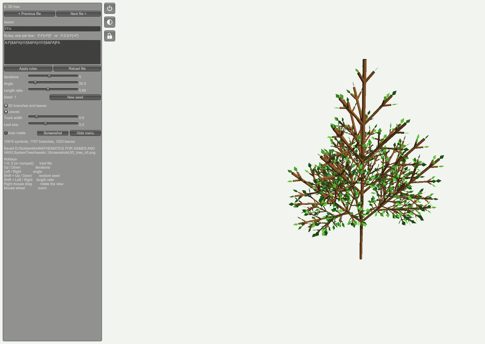
</p>

- **Report:** [`Report/YouzhiLi-L-system-2026.pdf`](Report/YouzhiLi-L-system-2026.pdf) (Chinese translation: [`-CN.pdf`](Report/YouzhiLi-L-system-2026-CN.pdf))
- **Video:** https://youtu.be/BUrIMRFPZxQ

## Features

- **Configuration files**: ten L-systems in `Assets/StreamingAssets/LSystems`, each loaded with its own number key.
  Files 1–6 are the six plants of Figure 1.24 a–f in *The Algorithmic Beauty of Plants*.
- **Step through the iterations** with the arrow keys and watch the plant grow.
- **Hotkeys for four parameters**: iterations, branching angle, branch length ratio and random seed.
- **Menu** (Unity IMGUI) with sliders, buttons and a **rule editor**, so new rules can be tried without leaving Play mode.
- **3D turtle** using a quaternion: `+ - & ^ \ / |` rotate around the turtle's own axes.
- **Stochastic rules**: a symbol can have several rules, each chosen with its probability.
- **3D branches and leaves**: each segment becomes a six-sided tube that gets thinner at every bracket, and a leaf
  grows at the end of each branch.
- **Orbit camera** that frames the whole model, with a rotation lock, a background colour switch and a quit button.

<p align="center">
  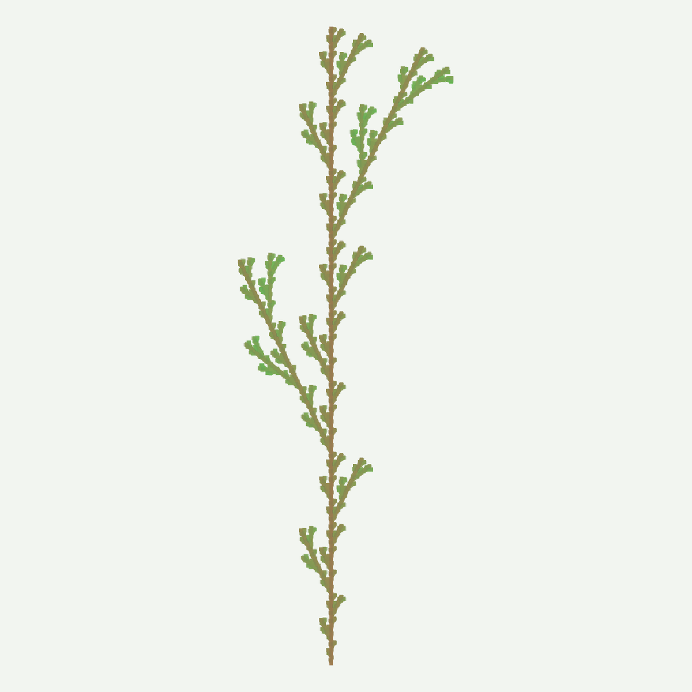 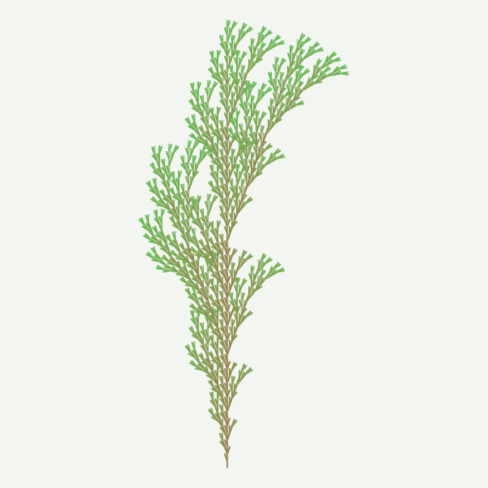 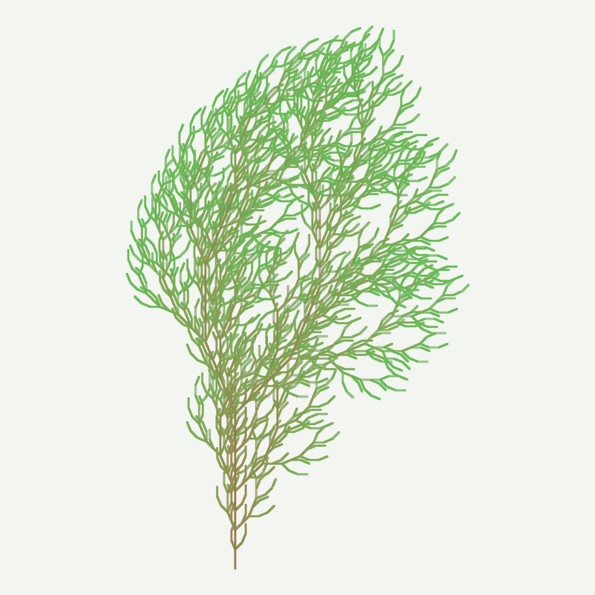
  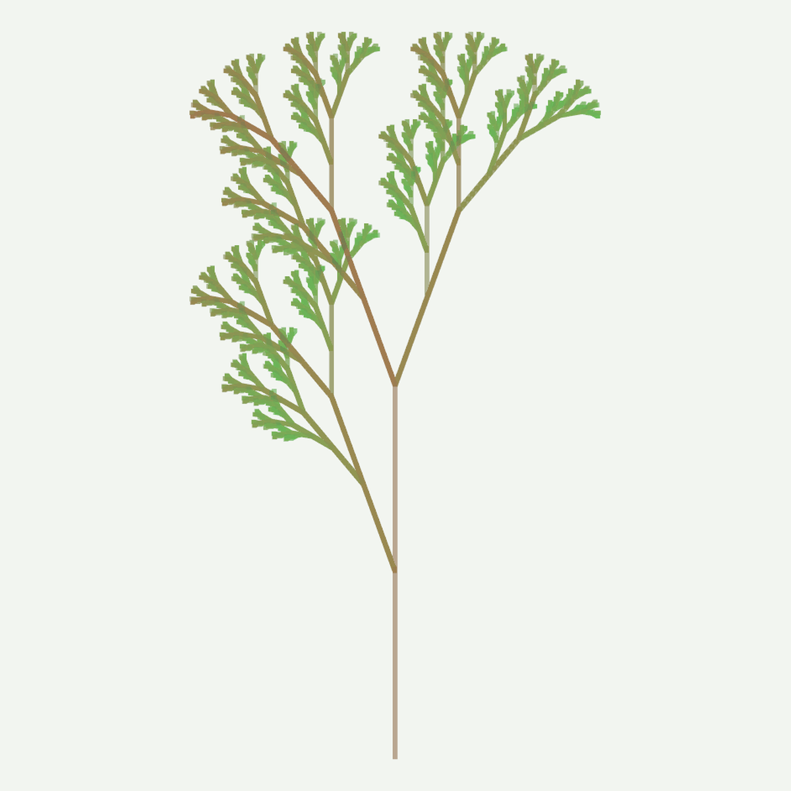 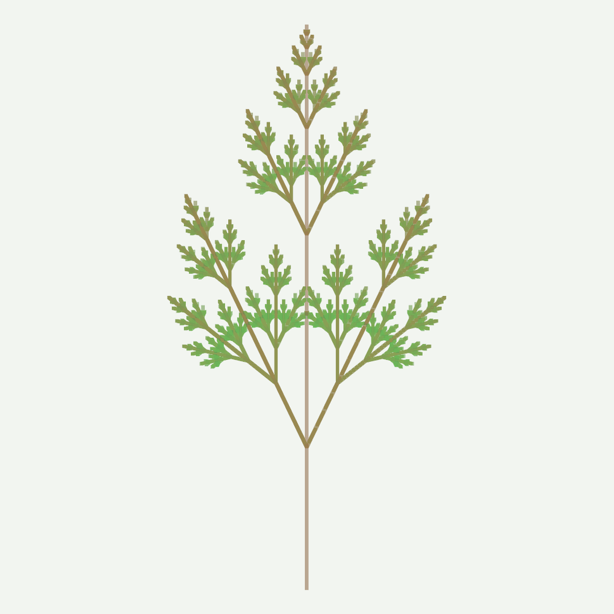 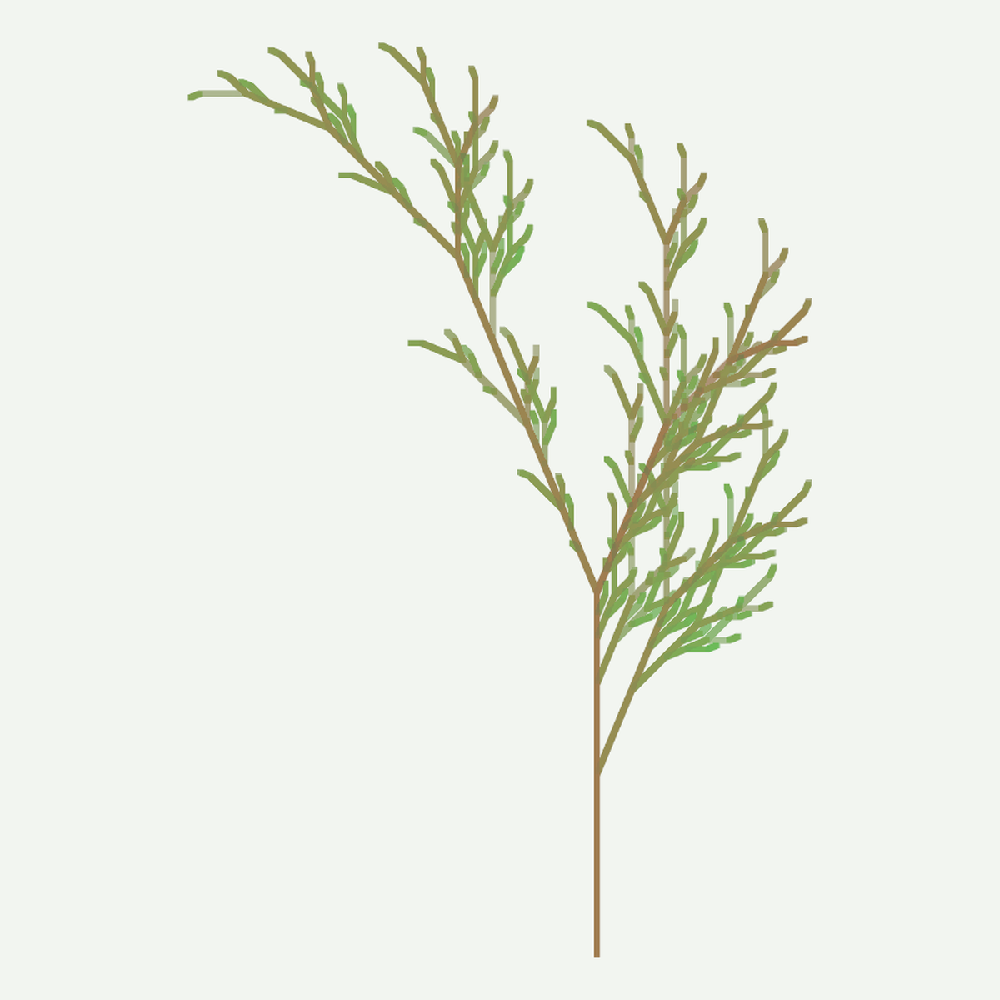
  <br><em>Files 1–6: Plants A–F (Prusinkiewicz &amp; Lindenmayer, 1990, Fig. 1.24 a–f)</em>
</p>

<p align="center">
  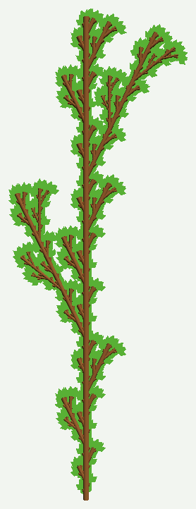 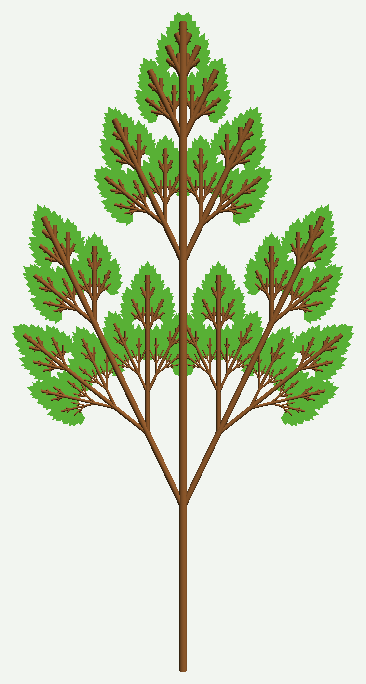
  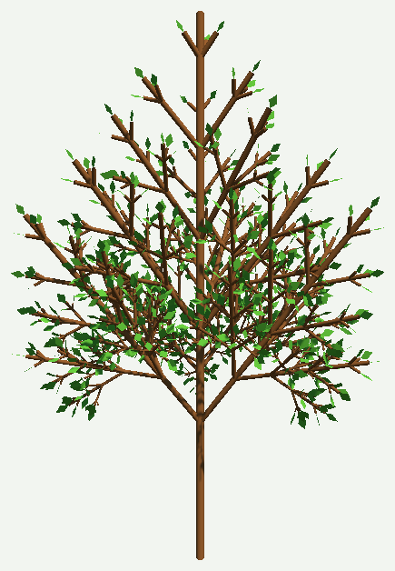 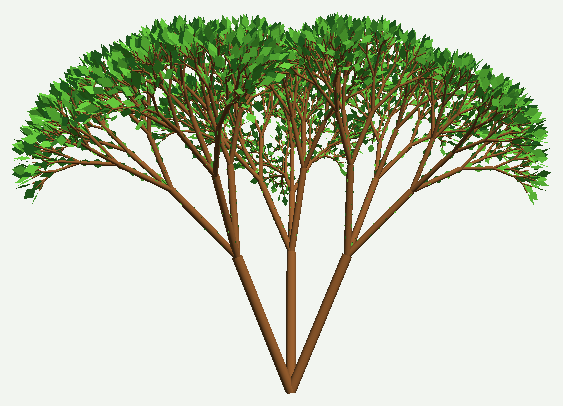
  <br><em>The same L-systems drawn with 3D branches and leaves</em>
</p>

## Running it

1. Open this folder with **Unity 6000.3.25f1** (Unity 6.3 LTS, Universal Render Pipeline).
2. Open `Assets/Scenes/SampleScene` and press **Play**.
   The `LSystem` object in the scene holds the `MyLSystem` script; it adds the camera and button scripts itself.
3. To make a Windows build: *File → Build Profiles → Windows → Build*.

## Controls

| Key | Action |
|---|---|
| `1`–`9`, `0` (top row or numpad) | Load configuration file 1–10 |
| `↑` / `↓` | Iterations +1 / −1 |
| `←` / `→` | Angle −1° / +1° |
| `Shift` + `↑` / `↓` | Random seed +1 / −1 |
| `Shift` + `←` / `→` | Branch length ratio −0.05 / +0.05 |
| Right mouse drag / wheel | Rotate the view / zoom |

Only the arrow and number keys are used, so the letters are free for typing in the menu.
While the cursor is in a text box, the hotkeys are switched off.

## Configuration file format

```ini
# Lines starting with # are comments
name=3D tree
axiom=FFA
rule=A:F[&&FA]/////[&&FA]///////[&&FA]FA
iterations=5
angle=20
ratio=0.65
```

A rule is `symbol:successor`, or `symbol:probability:successor` for a stochastic rule
(for example `rule=F:0.33:F[+F]F`). `ratio` (optional) makes each branch shorter than its parent.
The same format is used in the menu's rule editor.

| Symbol | Turtle command |
|---|---|
| `F`, `G` | Move forward and draw |
| `f` | Move forward without drawing |
| `+` / `-` | Turn left / right |
| `&` / `^` | Pitch down / up |
| `\` / `/` | Roll left / right |
| `\|` | Turn around |
| `[` / `]` | Save / restore the turtle (start / end a branch) |
| `L` | Leaf (a leaf is also added at every `]`) |

## Project structure

| Path | Contents |
|---|---|
| `Assets/Scripts/MyRewriter.cs` | `Rule` class; parallel (and stochastic) string rewriting |
| `Assets/Scripts/MyTurtle.cs` | 3D turtle with a quaternion and a stack; returns the segments and leaves |
| `Assets/Scripts/MyLSystem.cs` | Loads the files, hotkeys, menu and rule editor; builds the line or 3D mesh |
| `Assets/Scripts/MyCamera.cs` | Frames the model (d = r / sin(fov/2)), orbit camera, rotation lock |
| `Assets/Scripts/MyButtons.cs` | Quit, background colour and rotation lock buttons |
| `Assets/StreamingAssets/LSystems/` | The ten configuration files |
| `Assets/Resources/` | Button icons and the lit material used by the 3D mode |
| `Report/` | Report PDFs, the figures (output images) and the Python scripts that build the PDFs |

## References

- Prusinkiewicz, P., & Lindenmayer, A. (1990). *The Algorithmic Beauty of Plants*. Springer-Verlag.
  http://algorithmicbotany.org/papers/#abop
- Lindenmayer, A. (1968). Mathematical models for cellular interactions in development. *Journal of Theoretical Biology, 18*(3).
- Bourke, P. (1991). *L-system user notes*. http://paulbourke.net/fractals/lsys/

---

Youzhi Li · MSc Computer Game Programming · Goldsmiths, University of London · 2026
